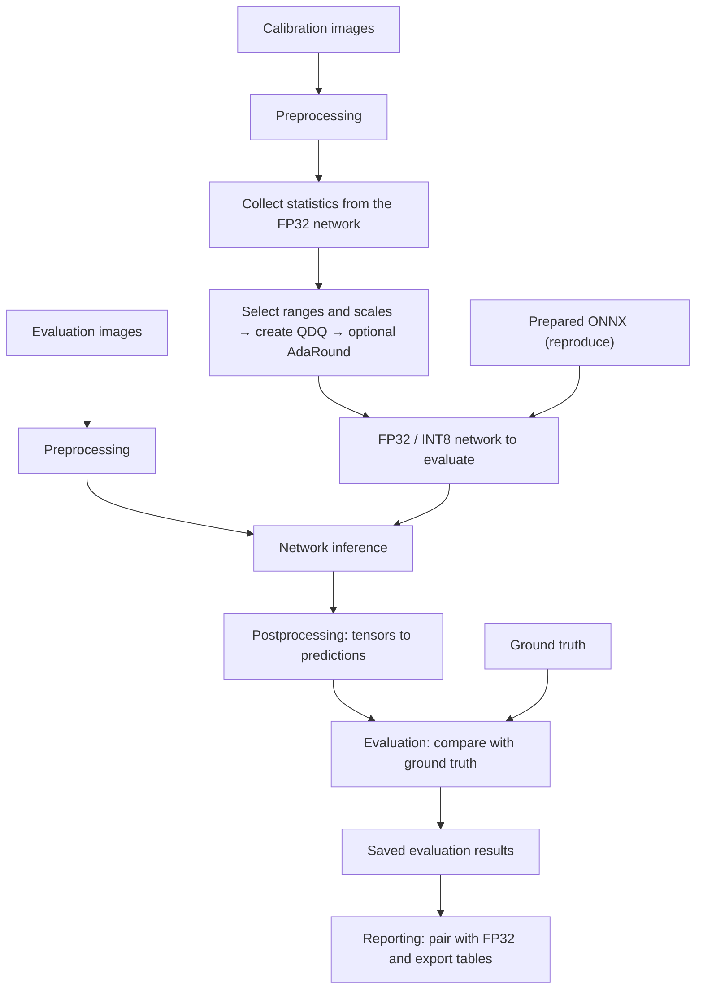

# How opennpu-quant works

opennpu-quant measures how much accuracy an INT8 model keeps relative to FP32. This page walks through the six stages between an image file and a row in the report, then maps them to the code. Commands and options are in [Run experiments](run-pipeline.md).

## Calibration data and evaluation data

Calibration data sets **the numerical ranges used for quantization**. Evaluation data measures **the accuracy of the finished model**. The two splits and their order are managed separately, and calibration needs neither ground truth nor NMS.

## 1. Preprocessing

Image files become tensors with the size, color order and normalization that the model expects. Preprocessing also keeps the original size, resize ratio and padding, so that boxes and masks can be mapped back to image coordinates.

These conventions differ by model, so each recipe names its input and preprocessing type. Some models also have a CPU `preprocess.onnx` graph. SSD, for example, takes a uint8 NHWC 320×320 input, and its network receives float32 NCHW 300×300 after the CPU graph. The recipe input and the network input can therefore differ, as listed in the [model reference](model-reference.md).

The data order is part of the input contract. Hashes cover the files, their order and the actual feeds, so a result computed with a different order or preprocessing is never reused.

## 2. Calibration

INT8 needs each tensor's numerical range. Calibration runs representative images through the FP32 model, first recording each activation's minimum and maximum and then accumulating fixed-bin histograms over that range.

Collecting statistics and selecting ranges are separate steps. A percentile-only change can reuse the statistics when the model, inputs, collection settings and runtime match. New images or a different bin count require collecting again. [Quantization logic](quantization.md) explains both steps.

## 3. Quantization

The statistics determine ranges, scales and zero points. The tool inserts `QuantizeLinear`/`DequantizeLinear` (QDQ) pairs at the selected boundaries and encodes weights and biases. PoT policies restrict scales to powers of two, and a `float` scale is still INT8 quantization, not an FP32 model.

RTN rounds each weight to the nearest integer code. AdaRound keeps the RTN encodings and learns whether each weight rounds up or down. A new percentile or scale policy is therefore a new quantization and training condition.

Audits check the QDQ parameters and the graph that ONNX Runtime executes. They also check that no QDQ sits inside a decomposed activation, such as `x * sigmoid(x)`. The audits cover ONNX Runtime behavior only ([Known limitations](validation.md#known-limitations)).

## 4. Postprocessing

Network outputs often need more work before they can be scored. Detection models decode candidate boxes and remove duplicates with NMS, and segmentation models rebuild masks. Both use the size, ratio and padding kept during preprocessing.

Postprocessing can combine a CPU `postprocess.onnx` graph with Python decoders. Quantization applies only to `network.onnx`, and the host graphs run on the CPU in FP32.

Clipping, sorting or serialization order can change a metric even when the network outputs are identical. Each model therefore has an evaluation profile that fixes this behavior, described in [Evaluation profiles](evaluation-profiles.md).

## 5. Evaluation

Evaluators compare the final predictions with the ground truth: Top-K accuracy for classification, AP for detection and pose, mask AP for instance segmentation, mIoU for semantic segmentation and pair accuracy for face verification. Each result stores the metrics with the actual sample count, full-evaluation status, input identity and profile.

AP on three images is a different measurement from AP on 5,000 images. [How to read a result](validation.md#how-to-read-a-result) explains what each kind of result shows.

## 6. Reporting

Reporting reads the saved evaluations and verifies their completion evidence. It pairs each INT8 result with the FP32 result of the same model, inputs, profile and scope, and computes recovery as `100 × INT8 / FP32`. Excel-compatible exports keep full and partial evaluations in separate files ([Reports](reporting.md)).

## run and reproduce

`run` reads an experiment file and performs calibration, quantization and evaluation. `reproduce` evaluates the fixed original models listed in the packaged selection, and an AdaRound condition there selects a model that is already trained. Both share the dataset, model bundle, evaluator, ONNX Runtime and QDQ audit components.

In `run`, the experiment file selects models, conditions and percentiles, and the model recipes define inputs and decoders. In `reproduce`, the packaged selection fixes all of these, and `bindings.json` only maps asset locations on your server. [Configuration reference](configuration.md#where-settings-live) lists where each setting lives.

`reproduce` does not go through the public Python API. It uses the shared components through these explicit entry points:

| Component | `run` | `reproduce` |
|---|---|---|
| Model bundle | `ModelBundle.from_directory()` opens the exported folder and checks it against `model.json` | `replay_bundle()` passes the verified selected graphs and output aliases, and reads no `model.json` |
| Dataset | The full prepared manifest. Calibration and evaluation use their separate splits | The same manifest or a frozen LFW cache. Full LFW scope is checked before execution in both commands |
| Evaluation | The public `evaluate()` | Its own loop, which runs each input twice and keeps per-sample evidence |
| QDQ audit | A separate session of the in-memory model | The session that runs inference |
| Code identity | `code_identity()` covers every packaged `.py` file. A change stops result reuse | The same identity stops an earlier run from resuming |
| Process settings | The CLI sets thread variables before numerical imports | One Torch thread and no TF32 during the replay, restored afterwards |

`reproduce prepare --model-set` and `reproduce configs --model-set` read the model lists of the `core10` and `cnn30` run presets, so editing those lists also changes the sets. `cnn30` is the default for packaged records. `all` uses every entry of the selection manifest. Existing prepared packages keep their original scope.

## Code map

The package lives in `src/opennpu_quant/`.

### Where to start reading

| Question | Start here |
|---|---|
| Which execution path does the CLI call? | `cli.py`, `runner.py`, `reproduction/cli.py`, `reproduction/execution.py` |
| How are settings and asset paths resolved? | `configuration.py`, `paths.py`, `reproduction/assets.py` |
| What decides reuse and cache keys? | `_identity.py` (code identity and source hashes), `runner.py` (condition and evaluation identities), `quant/storage.py` (statistics cache key), `data/samples.py` (input cache identity), `reproduction/execution.py` (replay identity) |
| Where are inputs and model conventions defined? | `data/`, `models/`, `resources/models/`, `resources/reproduction/selected.json` |
| How are statistics, quantization and AdaRound computed? | `api.py` → `quant/`, with graph analysis in `graph/` |
| Which environment runs ONNX? | `ort/`, `reproduction/environment.py` |
| Where are predictions and metrics computed? | `models/adapter.py`, `models/extended_decode.py`, `evaluation/` |
| How do evaluations become tables? | `report.py`, `reproduction/report.py`, then the shared `results.py` and `raw_report.py` |
| How are source models converted to ONNX? | `export/` |

The public Python API works without the CLI. `api.quantize` resolves arguments and defaults, `quant/api.py` connects statistics, ranges, the engine and AdaRound, and `quant/engine.py` builds the QDQ graph.

### run call sequence

`cli.py` loads the experiment, applies CLI overrides and validates the result through `configuration.py`. `runner.run()` owns the run directory and creates a `_ModelRun` for each model.

1. Lock the experiment directory and compare `effective_config.json`. A configuration change stops the run unless `--force` is given.
2. Resolve the recipe and evaluation defaults with `ModelSpec.for_run()`, open the exported model with `ModelBundle.from_directory()` and the dataset manifest with `Dataset`, then build the graph, input and evaluation identities.
3. For each condition, verify any existing completion evidence and reuse matching results ([Reuse and caching](run-pipeline.md#reuse-and-caching)).
4. For INT8, collect or load statistics once per model. Build RTN once per scheme family on the calibration device, then apply AdaRound where the condition asks for it.
5. Audit the QDQ graph that ONNX Runtime executes, run inference and pass the outputs to the shared `ModelEvaluator`.
6. Save the artifacts and metrics, then write `complete.json` with their hashes last.

### reproduce call sequence

`reproduction/cli.py` sends preparation to `prepare.py` and inference to `execution.py`. Preparation selects the requested models, resolves their assets through the bindings and records each verified condition. Execution loads each prepared model with `replay_bundle()`, runs every input twice to check repeatability and scores the outputs with the shared evaluator, keeping per-sample evidence for resume and comparison.

### From saved evaluations to tables

| Command | Record conversion and table output |
|---|---|
| `report` | `report.py` verifies local results, builds records with `_record` and calls `results.tables` |
| `results` | `results.py` validates portable records and calls `tables` |
| `reproduce report` | `reproduction/report.py` verifies the prepared and run bindings, converts completed results and calls `results.tables` |

`raw_report.py` applies the Excel-compatible table profile. None of these paths runs inference or touches the quantization core.

### Numerical determinism

ONNX Runtime always runs with `ORT_DISABLE_ALL`, and CUDA TF32 is disabled. If a requested CUDA execution is unavailable, the tool records a failure or pending work instead of a CPU result. The [GPU environment](reproducing-results.md#gpu-environment-and-numerical-verdicts) section lists what `reproduce` records and compares.

### Evaluation profile resolution

`ModelSpec.for_run()` selects the recipe for `run`, and `replay_bundle()` keeps the recipe snapshot of the packaged selection. Both build a `ModelEvaluator`, which resolves the evaluation profile once with `evaluation_contracts.resolve()`. The result holds the profile name, the Python postprocessor, the classification tie order and the COCO scoring options, and `ExtendedEvaluator` receives the same object.

For each sample, the network output passes through the CPU host graph in `ModelBundle.finish()`, then the selected Python postprocessor and finally the shared metric accumulator. `model_postprocess.py` adapts the generic decoders, and `historical_yolo.py` holds the Torch NMS arithmetic that the YOLO profiles preserve. A custom decoder from the [Python API](api.md#replace-python-postprocessing) plugs in at the same point.
