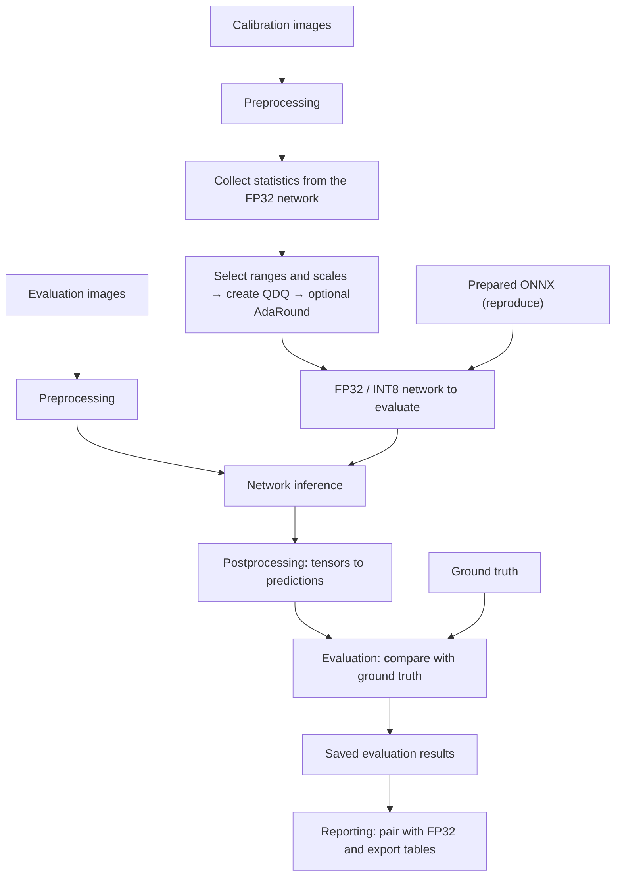

# How opennpu-quant works

opennpu-quant measures how much accuracy an INT8 model keeps relative to FP32. This page explains the six stages from an image to a report row, how `run` and `reproduce` differ, and the responsibilities of the main components. Implementation details follow for readers tracing the code. Commands and options are in [Run experiments](run-pipeline.md).

## Calibration data and evaluation data

Calibration data sets **the numerical ranges used for quantization**. Evaluation data measures **the accuracy of the finished model**. The two splits and their order are managed separately, and calibration needs neither ground truth nor NMS.

## 1. Preprocessing

Image files become tensors with the size, color order and normalization that the model expects. Preprocessing also keeps the original size, resize ratio and padding, so that boxes and masks can be mapped back to image coordinates.

These conventions differ by model, so each recipe names its input and preprocessing type. Some models also have a CPU `preprocess.onnx` graph. SSD, for example, takes a uint8 NHWC 320×320 input, and its network receives float32 NCHW 300×300 after the CPU graph. The recipe input and the network input can therefore differ, as listed in the [model reference](model-reference.md).

The data order is part of the input contract. Hashes cover the files, their order and the actual feeds, so a result computed with a different order or preprocessing is never reused.

## 2. Calibration

INT8 needs each tensor's numerical range. Calibration runs representative images through the FP32 model, first recording each activation's minimum and maximum and then accumulating fixed-bin histograms over that range.

Collecting statistics and selecting ranges are separate steps. A percentile-only change can reuse the statistics when the model, inputs, collection settings and runtime match. New images or a different bin count require collecting again. [Quantization logic](quantization.md) explains both steps.

## 3. Quantization

The statistics determine ranges, scales and zero points. The tool inserts `QuantizeLinear`/`DequantizeLinear` (QDQ) pairs at the selected boundaries and encodes weights and biases. PoT policies restrict scales to powers of two, and a `float` scale is still INT8 quantization, not an FP32 model.

RTN rounds each weight to the nearest integer code. AdaRound keeps the RTN encodings and learns whether each weight rounds up or down. A new percentile or scale policy is therefore a new quantization and training condition.

QDQ checks verify that the intended quantization parameters and boundaries remain in the graph loaded by ONNX Runtime. This helps establish which quantization condition the measured accuracy represents. [Shared validation](#shared-validation) explains the checks.

## 4. Postprocessing

Network outputs often need more work before they can be scored. Detection models decode candidate boxes and remove duplicates with NMS, and segmentation models rebuild masks. Both use the size, ratio and padding kept during preprocessing.

Postprocessing can combine a CPU `postprocess.onnx` graph with Python decoders. Quantization applies only to `network.onnx`, and the host graphs run on the CPU in FP32.

Clipping, sorting or serialization order can change a metric even when the network outputs are identical. Each model therefore has an evaluation profile that fixes this behavior, described in [Evaluation profiles](evaluation-profiles.md).

## 5. Evaluation

Evaluators compare the final predictions with the ground truth: Top-K accuracy for classification, AP for detection and pose, mask AP for instance segmentation, mIoU for semantic segmentation and pair accuracy for face verification. Each result stores the metrics with the actual sample count, full-evaluation status, input identity and profile.

AP on three images is a different measurement from AP on 5,000 images. [How to read a result](validation.md#how-to-read-a-result) explains what each kind of result shows.

## 6. Reporting

Reporting reads the saved evaluations and verifies their completion evidence. It pairs each INT8 result with the FP32 result of the same model, inputs, profile and scope, and computes recovery as `100 × INT8 / FP32`. Excel-compatible exports keep full and partial evaluations in separate files ([Reports](reporting.md)).

## run and reproduce

The two commands answer different questions. `run` measures the accuracy of models created under the experiment settings you choose. `reproduce` evaluates supplied models under their recorded conditions and checks whether repeated execution produces the same outputs. This distinction tells you whether a result describes a quantization experiment or a reevaluation of a fixed model.

### What a model bundle contains

A model bundle groups the files and connections needed to run a model:

- `network.onnx`, which performs the prediction computation.
- optional `preprocess.onnx` and `postprocess.onnx` files for processing around the network.
- information connecting the inputs and outputs of those graphs.

Not every model needs the optional graphs. Additional Python postprocessing and metric calculation belong to the evaluator. A model recipe describes the input format, preprocessing and how to interpret the outputs. Keeping this information with the network matters because changing preprocessing or output interpretation can change accuracy even when the network file stays the same. File layouts are in [Model bundles and recipes](models-and-data.md#model-bundles-and-recipes).

### Differences that affect result interpretation

The comparison below identifies where the evaluated model comes from, what work the command performs and what its result establishes.

| Aspect | `run` | `reproduce` |
|---|---|---|
| Model and settings | Starts from an exported FP32 model bundle. The experiment selects quantization conditions, and the model recipe supplies input and output conventions | Loads the selected FP32 or INT8 files and the recorded recipe, preserving the network and its associated processing |
| Quantization work | Collects calibration statistics and creates INT8 models. An AdaRound condition learns weight rounding. Matching completed work can be reused | Uses the already quantized model. An AdaRound condition selects the already trained file, with no calibration or training during replay |
| Input data | Uses calibration inputs to create INT8 models and a separate evaluation split to measure accuracy | Uses the recorded evaluation inputs and order. Calibration images are not needed for replay |
| Evaluation and repeatability | Measures accuracy for each experiment condition | Measures accuracy and runs each evaluated input twice in the same session, recording output equality and per-sample evidence |

For `reproduce`, `bindings.json` maps the recorded assets to locations on your server. It does not choose new quantization or evaluation settings. [Configuration reference](configuration.md#where-settings-live) explains where settings live. Repeating an input within one session checks local repeatability. Agreement with the original measurement or another GPU is a separate comparison described in [Reproducing results](reproducing-results.md#check-agreement-with-the-original-measurements).

### Shared validation

The commands share model execution, postprocessing, metric calculation and QDQ checking components. These checks give meaning to the reported accuracy:

- **QDQ parameters and boundaries:** accuracy alone does not establish that the intended quantization was used. For INT8, the checks compare quantized weights, scales and zero points with the quantization record, including the graph loaded by ONNX Runtime. They also verify protected activation boundaries, such as keeping QDQ out of the intermediate computation of `x * sigmoid(x)`. Both paths use the same runtime audit function. Its scope is ONNX Runtime, as explained in [Known limitations](validation.md#known-limitations).
- **Evaluation conditions:** shared metric code provides a common scoring implementation. Comparing repeated measurements of the same condition still requires matching model files, inputs and order, preprocessing, evaluation profile and sample scope. The saved records identify these conditions and whether evaluation was full or partial. See [How to read a result](validation.md#how-to-read-a-result).

## Main components and responsibilities

The processing described above is divided into the following components. Module paths are relative to `src/opennpu_quant/`.

| Component | Responsibility | Main modules |
|---|---|---|
| Experiment execution | Apply settings and coordinate model creation, evaluation and result storage | `cli.py`, `configuration.py`, `runner.py` |
| Fixed-model reproduction | Resolve the recorded assets and conditions, then run and record repeatability checks | `reproduction/` |
| Model preparation | Convert source models to ONNX files | `export/` |
| Model bundles and recipes | Connect network and host graphs, and define input and output conventions | `models/bundle.py`, `models/spec.py`, `resources/models/` |
| Data preparation | Read dataset manifests, prepare samples and keep calibration and evaluation inputs separate | `data/` |
| Quantization | Collect statistics, select ranges, build QDQ models and apply AdaRound | `quant/`, `graph/` |
| ONNX execution | Create runtime sessions and execute the graphs with the requested device settings | `ort/` |
| Postprocessing and evaluation | Convert outputs to predictions and accumulate task metrics | `models/adapter.py`, `models/extended_decode.py`, `evaluation/` |
| Reporting | Validate saved results, pair INT8 with FP32 and produce tables | `report.py`, `reproduction/report.py`, `results.py`, `raw_report.py` |

If needed, the [Python API](api.md) lets you integrate calibration, quantization and evaluation into your own code. `api.py` exposes these operations and delegates to the components above.

## Implementation details

The following sections connect the responsibilities above to concrete functions and execution order. They are useful when tracing or changing the implementation.

### run call sequence

`cli.py` loads the experiment, applies CLI overrides and validates the result through `configuration.py`. `runner.run()` owns the run directory and creates a `_ModelRun` for each model.

1. Lock the experiment directory and compare `effective_config.json`. A configuration change stops the run unless `--force` is given.
2. Resolve the recipe and evaluation defaults with `ModelSpec.for_run()`, open the exported model with `ModelBundle.from_directory()` and the dataset manifest with `Dataset`, then build the graph, input and evaluation identities. The bundle checks its graph files against `model.json` when that file is present.
3. For each condition, verify any existing completion evidence and reuse matching results ([Reuse and caching](run-pipeline.md#reuse-and-caching)).
4. For INT8, collect or load statistics once per model. Build RTN once per scheme family on the calibration device, then apply AdaRound where the condition asks for it.
5. Audit the QDQ graph, then call `evaluate()` to run inference and pass the outputs to the shared `ModelEvaluator`.
6. Save the artifacts and metrics, then write `complete.json` with their hashes last.

### reproduce call sequence

`reproduction/cli.py` sends preparation to `prepare.py` and inference to `execution.py`. Preparation selects the requested models, resolves their assets through the bindings and records each verified condition. `replay_bundle()` builds the bundle from verified graph paths, the recorded recipe and output aliases. It reads no `model.json`. The selection records supply the file hashes used for verification.

Execution uses its own inference loop to run each input twice, then scores the outputs with the shared `ModelEvaluator`. Per-sample records support repeatability checks, resume and comparison. This loop handles reproduction-specific recording while reusing the same postprocessing and metric components as `run`.

Model selection for `reproduce prepare --model-set` and `reproduce configs --model-set` reads the `core10` and `cnn30` preset lists, so editing a list changes newly prepared selections. Existing prepared packages retain their scope. Defaults and the `all` option are described in [Choose a model set](reproducing-results.md#choose-a-model-set).

### QDQ audit sessions

In `run`, `runner.runtime_audit()` saves the newly quantized model and opens a separate ONNX Runtime session to inspect its serialized execution graph before evaluation. In `reproduce`, the execution graph comes from the session used for evaluation. Both call `quant.engine.audit_runtime()` to check parameters and protected activation boundaries. The session arrangement reflects where each execution path performs the shared checks.

### Result reuse and resume

Saved results include identities for the model, inputs, settings and implementation. `code_identity()` in `_identity.py` hashes every packaged `.py` file so a code change prevents `run` from reusing an earlier result and `reproduce` from resuming an earlier execution under the same identity. This avoids combining results produced by different implementations. Completion records also check that saved artifacts are intact. See [Reuse and caching](run-pipeline.md#reuse-and-caching) and [Resume an interrupted run](reproducing-results.md#resume-an-interrupted-run).

### From saved evaluations to tables

| Command | Record conversion and table output |
|---|---|
| `report` | `report.py` verifies local results, builds records with `_record` and calls `results.tables` |
| `results` | `results.py` validates portable records and calls `tables` |
| `reproduce report` | `reproduction/report.py` verifies the prepared and run bindings, converts completed results and calls `results.tables` |

`raw_report.py` applies the Excel-compatible table profile. None of these paths runs inference or touches the quantization core.

### Execution environment

The `run` and `reproduce` workflows use `ORT_DISABLE_ALL` and disable CUDA TF32. The CLI configures thread environment variables before importing numerical libraries. When Torch is available, reproduction also sets one Torch thread and disables its TF32 settings for the replay, restoring them afterwards. These settings control execution conditions that can affect numerical results.

If a requested CUDA execution is unavailable, the tool records a failure or pending work. The [GPU environment](reproducing-results.md#gpu-environment-and-numerical-verdicts) section explains how recorded software and GPU information is used when comparing executions.

### Evaluation profile resolution

`ModelSpec.for_run()` selects the recipe for `run`, and `replay_bundle()` keeps the recipe snapshot of the packaged selection. Both build a `ModelEvaluator`, which resolves the evaluation profile once with `evaluation_contracts.resolve()`. The result holds the profile name, the Python postprocessor, the classification tie order and the COCO scoring options, and `ExtendedEvaluator` receives the same object.

For each sample, the network output passes through the CPU host graph in `ModelBundle.finish()`, then the selected Python postprocessor and finally the shared metric accumulator. `model_postprocess.py` adapts the generic decoders, and `historical_yolo.py` holds the Torch NMS arithmetic that the YOLO profiles preserve. A custom decoder from the [Python API](api.md#replace-python-postprocessing) plugs in at the same point.
